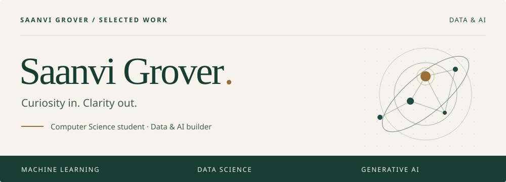

<picture>
  <source media="(max-width: 600px)" srcset="./assets/profile-header-mobile.svg" />
  
</picture>

  <a href="https://saanvi-portfolio-kappa.vercel.app/"><strong>Explore my portfolio ↗</strong></a>
  &nbsp;&nbsp; / &nbsp;&nbsp;
  <a href="https://www.linkedin.com/in/saanvi-grover-01a4b41b7">LinkedIn</a>
  &nbsp;&nbsp; / &nbsp;&nbsp;
  <a href="mailto:saanvigrover2007@gmail.com">Email</a>

# Turning data into something useful.

I'm **Saanvi**, a Computer Science student building at the intersection of **machine learning, data science, and generative AI**. I take projects from raw data and exploration through models, APIs, and thoughtful interfaces.

My focus is practical: systems that are explainable, responsible, and useful to the people working with them.

> **Currently exploring** · Generative AI, MLOps, data engineering, and cloud deployment.

## Selected work

Six projects, from ocean intelligence to everyday analytics.

### 01 / FloatChat
**Ocean data, in plain language.**

Built the AI backend for a system that answers questions over **12,442 real ARGO ocean-float profiles**, combining RAG over schema, natural-language-to-SQL, and a query safety layer.

**Finalist · ANALYTICA 2026** National-Level Data Science Hackathon · Team Entropy.

`Python` `RAG / NL→SQL` `PostGIS` `FastAPI`

---

### 02 / [SkillLens ↗](https://github.com/SaiGrover/SkillLens)
**A clearer view of tomorrow's skills.**

An AI-powered workforce intelligence platform for skill forecasting, industry insights, and evidence-based career planning. Built during a mentorship at **Persistent Systems**.

`Machine learning` `K-Means` `Forecasting`

---

### 03 / [HeatFluxAI ↗](https://github.com/SaiGrover/HeatFluxAI)
**Understanding the heat in our cities.**

Estimates urban heat island intensity across **25 global cities** using ERA5 and MODIS data. Compared eight regression models; XGBoost achieved the best **RMSE of approximately 2.14°C**.

`XGBoost` `Feature engineering` `Streamlit`

---

### 04 / [HR TalentScope ↗](https://github.com/SaiGrover/TalentScope)
**Workforce insights, backed by evidence.**

An HR analytics platform built on **19,000+ employee records** to predict attrition risk. Compares five ML models and brings workforce insights into a dashboard with more than ten modules.

`Classification` `EDA` `Analytics`

---

### 05 / [Campus Lens ↗](https://github.com/SaiGrover/Campus-Lens)
**Making student feedback easier to act on.**

A text-mining platform that classifies student complaints and surfaces recurring issues, locations, and trends for institutions.

`NLP` `Text classification` `Next.js`

---

### 06 / [DataStory AI ↗](https://github.com/SaiGrover/DataStory-AI)
**From messy CSVs to model-ready data.**

An AI-assisted workspace for cleaning CSVs, automating exploratory analysis, handling class imbalance, and tuning machine learning models with grid search.

`AutoML` `GridSearchCV` `Plotly`

**[Browse all repositories →](https://github.com/SaiGrover?tab=repositories)**

## The toolkit

**Languages** 
Python · SQL · C++ · JavaScript · TypeScript

**Data & intelligence** 
Pandas · NumPy · scikit-learn · XGBoost · RAG / LLMs · Plotly · Power BI · Tableau

**Applications & APIs** 
React · Next.js · FastAPI · Flask · Streamlit

**Data stores & development** 
PostgreSQL · PostGIS · MySQL · Prisma · Supabase · Git · GitHub · Anaconda · Vercel

## Along the way

- **ANALYTICA 2026 — Finalist** 
  National-Level Data Science Hackathon, VESASC, Mumbai.
- **Statistella BASH 8.0 — Finalist** 
  Data Analytics Competition · **Rank 1**, Tableau Dashboard Design Round 1.
- **AI & ML Certification — CGPA 9.16** 
  Vishlesan i-Hub, IIT Patna / Masai · Three Certificates of Excellence.
- **Google** 
  Advanced Data Analytics · AI Essentials.
- **HackerRank** 
  SQL Basic, Intermediate & Advanced · Python Basic.

## Let's build something useful.

Interested in machine learning, analytics, explainable AI, generative AI, or data-driven products? I'd be happy to connect.

**[Say hello →](mailto:saanvigrover2007@gmail.com)** · [LinkedIn](https://www.linkedin.com/in/saanvi-grover-01a4b41b7) · [Portfolio](https://saanvi-portfolio-kappa.vercel.app/)

Copyright © 2026 Saanvi Grover. All rights reserved. Unless expressly stated otherwise, no permission is granted to copy, modify, distribute, commercialize, or create derivative works from my original work without prior direct written permission. See <a href="LICENSE">LICENSE</a>.
